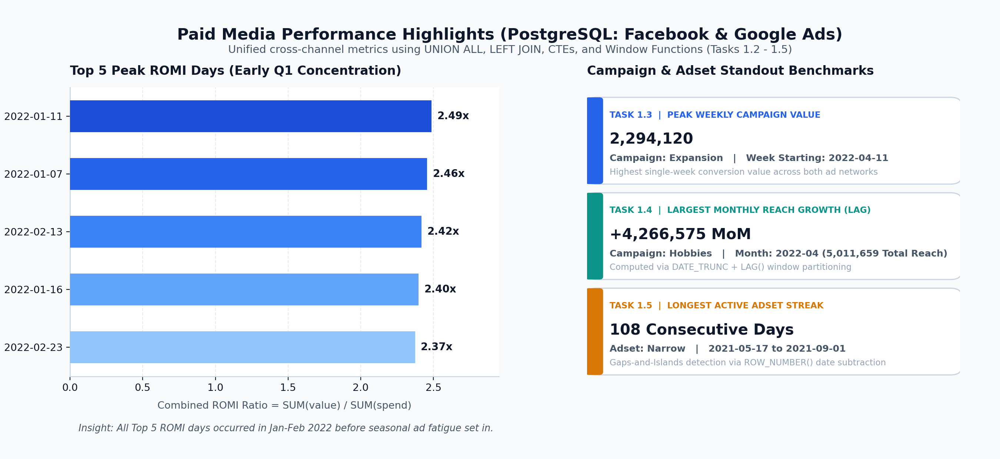
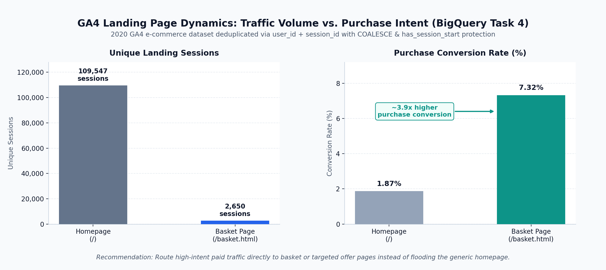
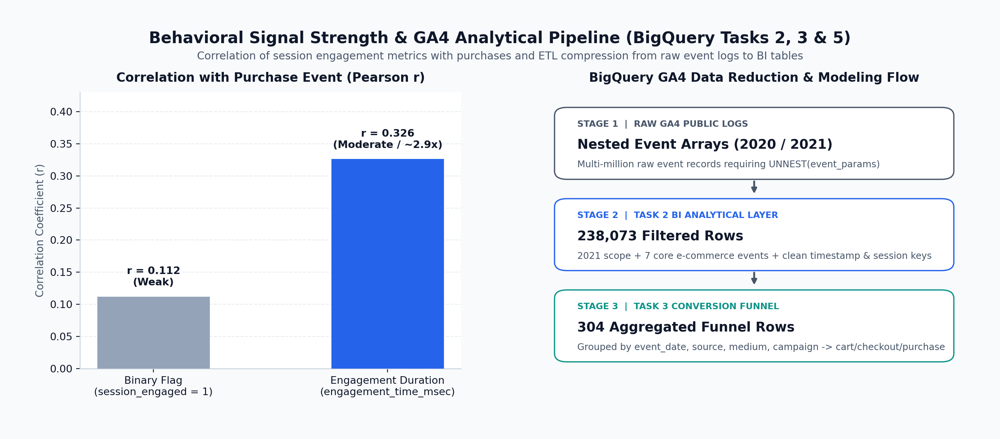

# Cross-Channel Marketing & E-Commerce Analytics (SQL Case Study)

**End-to-end performance, funnel diagnostics, and behavioral analytics spanning paid acquisition (PostgreSQL) and on-site GA4 event logs (Google BigQuery).**

---

## Executive Summary

Marketing performance rarely breaks down inside a single tool—ad networks report clicks and spend, while on-site event streams reveal where visitors actually convert or drop off. This case study bridges both halves across **two SQL environments**:

1. **Paid Media Acquisition (PostgreSQL):** Unifies Facebook Ads and Google Ads daily delivery tables to evaluate spend volatility, peak **ROMI (Return on Marketing Investment)** timing, weekly campaign revenue drivers, month-over-month reach scaling, and adset delivery streaks (`1,015` daily channel summaries distilled into clear campaign winners).
2. **E-Commerce User Journey & Conversion Analytics (Google BigQuery GA4):** Flattens nested `event_params` arrays from public Google Analytics 4 e-commerce logs to build a `238,073`-row BI analytical layer, a `304`-row channel conversion funnel, landing-page intent comparisons (`/` vs. `/basket.html`), and Pearson correlation tests linking engagement depth to purchases.

---

## Architecture & Repository Structure

| Directory / File | Platform | Purpose |
|---|---|---|
| [`sql/postgresql/01_daily_spend_distribution.sql`](sql/postgresql/01_daily_spend_distribution.sql) | PostgreSQL | Daily channel spend `AVG`, `MAX`, `MIN` summary (`1,015` rows) |
| [`sql/postgresql/02_top_romi_days.sql`](sql/postgresql/02_top_romi_days.sql) | PostgreSQL | Top 5 combined daily ROMI dates (`2.37x` – `2.49x`) |
| [`sql/postgresql/03_top_weekly_campaign_value.sql`](sql/postgresql/03_top_weekly_campaign_value.sql) | PostgreSQL | Peak weekly conversion value (`Expansion`: `2,294,120`) |
| [`sql/postgresql/04_monthly_reach_growth_mom.sql`](sql/postgresql/04_monthly_reach_growth_mom.sql) | PostgreSQL | Steepest MoM reach expansion via `LAG()` (`Hobbies`: `+4,266,575`) |
| [`sql/postgresql/05_longest_active_adset_streak.sql`](sql/postgresql/05_longest_active_adset_streak.sql) | PostgreSQL | Gaps-and-islands consecutive streak via `ROW_NUMBER()` (`Narrow`: `108` days) |
| [`sql/bigquery/01_ga4_bi_event_layer_2021.sql`](sql/bigquery/01_ga4_bi_event_layer_2021.sql) | BigQuery | Cleaned 2021 BI table across 7 e-commerce events (`238,073` rows) |
| [`sql/bigquery/02_channel_conversion_funnel.sql`](sql/bigquery/02_channel_conversion_funnel.sql) | BigQuery | Multi-step funnel by date & traffic source (`304` rows) |
| [`sql/bigquery/03_landing_page_conversion_dynamics.sql`](sql/bigquery/03_landing_page_conversion_dynamics.sql) | BigQuery | 2020 landing page conversion comparison with `COALESCE` + `has_session_start` |
| [`sql/bigquery/04_engagement_purchase_correlation.sql`](sql/bigquery/04_engagement_purchase_correlation.sql) | BigQuery | Pearson `CORR()` comparing binary engagement (`0.112`) vs. duration (`0.326`) |
| [`docs/sql_methodology.md`](docs/sql_methodology.md) | Documentation | Technical deep dive on joins, windowing, `UNNEST()`, and edge-case protection |

---

## Part 1: Paid Media Performance Analysis (PostgreSQL)

### Key Empirical Findings
- **Spend Volatility:** Daily minimum, average, and maximum spend across Facebook and Google Ads (`1,015` daily channel records) revealed steep intra-period fluctuations rather than flat pacing, indicating reactive budget allocation tied to real-time demand.
- **Early-Q1 ROMI Peak Concentration:** All top 5 combined daily ROMI dates occurred in **January and February 2022**—led by **`2022-01-11` (`2.49` / `2.4869`)**, **`2022-01-07` (`2.46`)**, **`2022-02-13` (`2.42`)**, **`2022-01-16` (`2.40`)**, and **`2022-02-23` (`2.37`)**—before seasonal auction fatigue compressed returns.
- **Primary Revenue Engine:** Campaign **`Expansion`** generated **`2,294,120`** in single-week conversion value during the week of **`2022-04-11`**, standing out as the main revenue locomotive.
- **Rapid Audience Scaling:** Using `DATE_TRUNC` + `LAG()` window partitioning, campaign **`Hobbies`** posted **`+4,266,575`** net month-over-month reach growth in **`2022-04`**, reaching **`5,011,659`** monthly impressions/reach.
- **Delivery Stability (Gaps-and-Islands):** Using `ROW_NUMBER()` and date subtraction (`ad_date - rn * interval '1 day'`), adset **`Narrow`** demonstrated **`108` consecutive active days** (`2021-05-17` to `2021-09-01`) without delivery interruption.

---

## Part 2: E-Commerce Funnel & GA4 Behavioral Analytics (Google BigQuery)

### Critical Engineering & Data Quality Solutions
- **Nested Parameter Extraction:** Extracted `ga_session_id`, `page_location`, `session_engaged`, and `engagement_time_msec` from repeated `event_params` records using scalar `UNNEST()` subqueries without multiplying row cardinality.
- **Composite Session Deduplication:** Because `ga_session_id` is not globally unique across users in GA4 exports, unique sessions were strictly keyed by **`user_pseudo_id` + `session_id`**.
- **Edge-Case Protection (`COALESCE` + `has_session_start`):** Guarded against missing `session_start` triggers and `NULL` landing-page paths using conditional session flags (`has_session_start = 1`) and `COALESCE(landing_page, '(not set)')` rather than naive `WHERE` filtering that silently drops valid visitor activity.

### Key Empirical Findings
- **Homepage Volume vs. Basket Conversion Intent:** On 2020 GA4 data, the homepage **`/`** captured **`109,547` sessions** with a **`1.87%`** purchase conversion rate, whereas **`/basket.html`** drove **`7.32%`** conversion across **`2,650` sessions**—nearly **4x (~3.9x) stronger conversion efficiency**.

- **ETL Compression for BI Readiness:** Filtering 2021 raw nested GA4 logs to 7 core e-commerce events (`session_start`, `view_item`, `add_to_cart`, `begin_checkout`, `add_shipping_info`, `add_payment_info`, `purchase`) produced a clean **`238,073`-row** BI layer, subsequently aggregated into a **`304`-row** date-and-channel conversion funnel.
- **Engagement Quality Beats Binary Clicks:** Computing Pearson `CORR()` across deduplicated sessions showed that binary engaged status (`session_engaged = 1`) holds only a weak relationship with purchasing (**`r = 0.112`**), while total session duration (`engagement_time_msec`) exhibits an approximately **3x stronger** positive correlation (**`r = 0.326`**).

---

## Strategic Recommendations

1. **Front-Load High-Intent Budgets into Q1 Windows:** Prioritize budget allocation toward early-Q1 periods where ROMI consistently exceeds `2.37x`–`2.49x`, and anchor scale around proven revenue engines like **`Expansion`** and narrow-targeted evergreen adsets like **`Narrow`**.
2. **Shift Paid Landing Destinations from Generic Homepage to Action Pages:** Rather than sending high-intent traffic strictly to `/` (`1.87%` conversion), test routing high-intent campaign segments to targeted product/offer or basket recovery flows modeled after `/basket.html` (`7.32%` conversion).
3. **Optimize Creative & On-Site UX for Depth of Engagement:** Since `engagement_time_msec` (`r = 0.326`) outperforms shallow click/engaged flags (`r = 0.112`) by ~3x as a purchase predictor, shift campaign evaluation away from raw CTR toward post-click dwell depth and checkout friction reduction (particularly cart-to-checkout drop-off).
4. **Build Unified Acquisition-to-Session Warehousing (Next Step):** Join the harmonized PostgreSQL ad spend model with BigQuery GA4 session attribution (`user_pseudo_id` + `session_id`) inside a unified warehouse layer to track end-to-end **CAC** and **LTV** per campaign.
